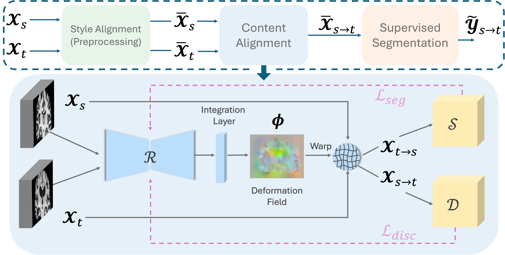

# Unsupervised Domain Adaptation via Content Alignment for Hippocampus Segmentation

<p align="center">
  
</p>

This repository contains the code (in PyTorch) for the framework introduced in the following paper:

Unsupervised Domain Adaptation via Content Alignment for Hippocampus Segmentation
[[Paper]](https://arxiv.org/abs/2510.13075) | [[Project Page]](https://hodakalabizadeh.github.io/projects/content-alignment/)


## Citation

```bibtex
@inproceedings{kalabizadeh2025content,
  title     = {Unsupervised Domain Adaptation via Content Alignment for Hippocampus Segmentation},
  author    = {Kalabizadeh, Hoda and Griffanti, Ludovica and Yeung, Pak-Hei and Namburete, Ana I. L. and
               Dinsdale, Nicola K. and Kamnitsas, Konstantinos},
  booktitle = {Proceedings of the IEEE/CVF International Conference on Computer Vision Workshops (ICCVW)},
  year      = {2025},
  doi       = {10.1109/ICCVW69036.2025.00119}
}
```


## Contents
  1. [Overview](#overview)
  2. [Repository layout](#repo-layout)
  3. [Installation](#installation)
  4. [Data](#data)
  5. [Running](#running)

## Overview

We propose an image-space unsupervised domain adaptation (UDA) framework for segmentation across a **labelled source** and an **unlabelled target** domain. The framework addresses two types of domain shift: **style** (image intensity and appearance) and **content** (anatomical differences between populations).

The framework consists of three stages:

1. **Style Alignment:** Histogram standardisation and z-normalisation are applied to reduce intensity differences between domains.

2. **Content Alignment (CA):** A bidirectional diffeomorphic registration network **R** learns anatomical transformations between source and target images. It is jointly trained with:
   - A discriminator **D**, which encourages warped source images to resemble target images.
   - A segmenter **S**, which provides segmentation-based feedback to guide registration towards anatomically relevant regions.

3. **Downstream Segmentation:** The trained registration network is used to warp source images and their corresponding labels towards the target domain. These transformed image-label pairs are then used to train a downstream segmentation model, which is evaluated on unseen target images.
   

## Repository layout

```
ca_core/
  datasets/       mri.py (3D brain MRI pairs), mnist.py (Morpho-MNIST pairs),
                  MNI152_template.nii.gz (the MNI template the MRI volumes are registered to; own licence)
  models/         registration.py (R), discriminator.py (D), segmentation.py (S and downstream U-Net), warping.py
  training/       content_alignment.py (one CA epoch), downstream_segmentation.py, losses.py
  evaluation.py   Dice, surface Dice, 95% Hausdorff distance, RAVD
configs/          obhc.yaml, harp.yaml (DRYAD -> OBHC / HarP), mnist.yaml (thick -> thin digits)
scripts/          train_content_alignment.py, eval_content_alignment.py,
                  train_downstream_seg.py, eval_downstream_seg.py, slurm/ (job scripts)
requirements.txt  Python dependencies
```

## Installation

Clone the repository, then from its root:

```bash
conda create -n ca python=3.11 && conda activate ca
pip install -r requirements.txt
```

Tested with PyTorch 2.0.1 on an NVIDIA A10 GPU.

## Data

The MRI experiments use DRYAD as the source domain and OBHC or HarP as the target domain. Expected input:

- NIfTI volumes, already affinely registered to 1 mm MNI space, skull-stripped and bias-corrected (N4).
  The MNI template used is `ca_core/datasets/MNI152_template.nii.gz` (ICBM 2009a Nonlinear Symmetric,
  197 × 233 × 189; see `ca_core/datasets/MNI152_template_NOTICE.md`); the ROI crop assumes this grid;
- a hippocampus label map for each volume (any value > 0 is foreground).

By default the configs read the data from `data/` in the repository root (`data_root`); put or link the
datasets there, or set `data_root` to your data folder. The train/test image and label folders are listed
under `data:`, relative to `data_root`. Each volume is then:

1. histogram-standardised over the brain (voxels above 10% of the volume's 99th percentile), with
   landmarks fitted on the source and target training volumes together
2. z-normalised over the brain
3. cropped to a (96, 128, 80) hippocampal region of interest

### Morpho-MNIST (2D demo)

The 2D experiment (`configs/mnist.yaml`, thick → thin digits rendered MNIST-M style) is the one you can run
end to end without the clinical MRI data. Fetch its two Morpho-MNIST styles (`thic` source, `thin` target)
into `data/mnist/`:

```bash
python scripts/download_data.py          # ~22 MB; verifies each file's SHA-256
```

CIFAR-10 and raw MNIST are downloaded automatically by torchvision on first run, so they need no action. The
Morpho-MNIST data is redistributed from [Morpho-MNIST](https://github.com/dccastro/Morpho-MNIST) (MIT
License); if you use it, please also cite Castro et al., *Morpho-MNIST: Quantitative Assessment and
Diagnostics for Representation Learning*, JMLR 20(178), 2019. If the release asset is unavailable, the script
prints the official download links as a fallback.


## Running

From the repository root, with `PYTHONPATH` set to it:

```bash
python scripts/train_content_alignment.py --config configs/obhc.yaml --run-name ca   # train R + D + S, every CA fold
python scripts/eval_content_alignment.py  --config configs/obhc.yaml --run-name ca   # label propagation on the training data
python scripts/train_downstream_seg.py    --config configs/obhc.yaml --run-name ca   # segmenter on CA-aligned source data
python scripts/eval_downstream_seg.py     --config configs/obhc.yaml --run-name ca   # Dice etc. on the target test set
```

On a Slurm cluster, `bash scripts/slurm/run_all.sh obhc ca` submits the stages as chained jobs, with one
job per CA fold; `bash scripts/slurm/run_all.sh obhc ca_s43 43 "42 43 44"` uses CA seed 43 and three
downstream seeds. Outputs go to `outputs/<config>/<run-name>/`.

- **Ablations:** `--lambda-disc 0` and/or `--lambda-seg 0` switch off D and/or S.
- **CA training:** k-fold cross-validation (`ca.folds`, 3), split with `--seed`.
  - Each fold's CA model is trained on the other folds and early-stopped on R's validation loss on its
    own fold, which does not use target labels. `--fold k` trains a single fold.
  - Saves `ca_fold<k>.pt` and `ca_fold<k>.json` (best validation loss and epoch) per fold.
- **Choosing the CA model:** the downstream stage uses the fold with the lowest validation loss
  (`ca_core.utils.select_ca_fold`). Target labels are never used for this choice; the registration
  Dice in `ca_eval.csv` is for reporting only.
- **Downstream segmenter:** trained with k-fold cross-validation (`downstream.folds`, 3), and
  evaluated as the mean over the k fold models. Outputs of each downstream seed go to
  `downstream_seed<seed>/`.


## License

MIT; see [LICENSE](LICENSE). The MNI template in `ca_core/datasets/` is distributed under its own notice
(McConnell Brain Imaging Centre); see [MNI152_template_NOTICE.md](ca_core/datasets/MNI152_template_NOTICE.md).
The Morpho-MNIST data fetched by `scripts/download_data.py` is redistributed from
[Morpho-MNIST](https://github.com/dccastro/Morpho-MNIST) under the MIT License (© 2019 Daniel C. Castro et al.).
